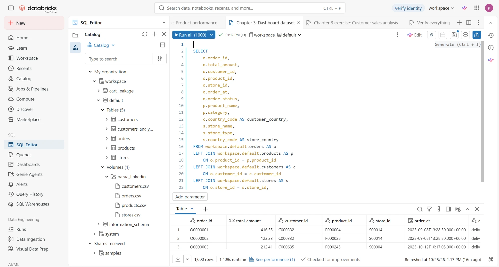
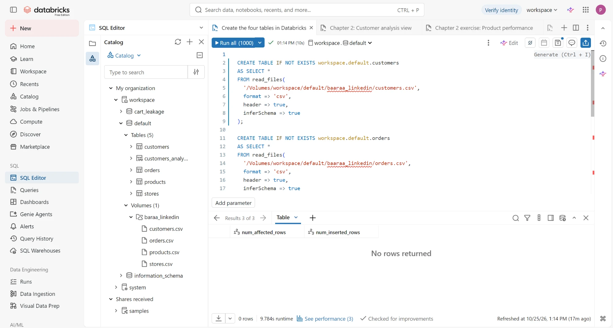
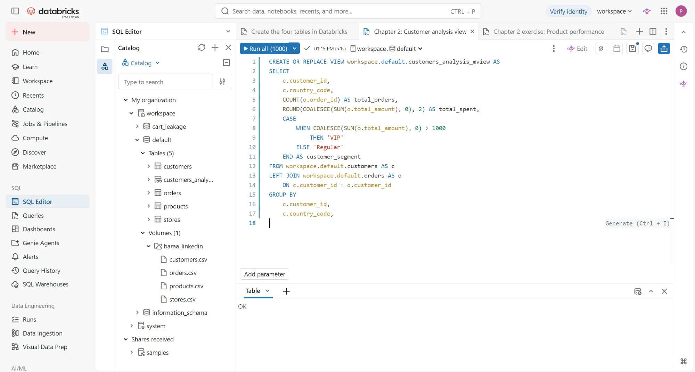
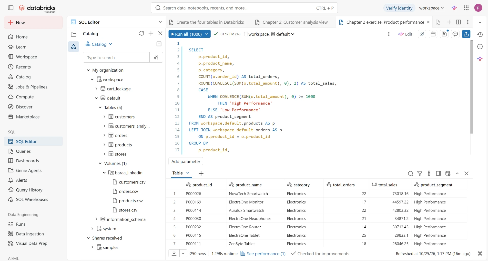
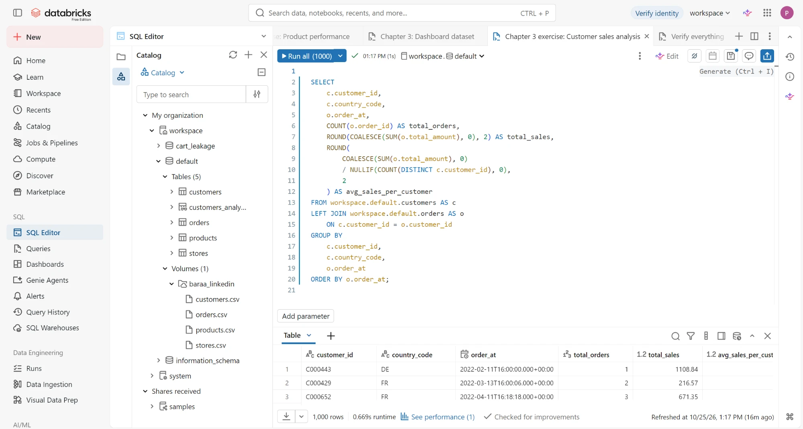

# Databricks SQL Analytics: DataMart Retail Sales


A retail sales analysis built in **Databricks SQL**: 4 tables (800 customers, 4,494 order lines, 250 products, 20 stores across 10 European countries, 2022 to 2025) loaded from a Unity Catalog Volume into Delta tables, checked, and turned into reusable SQL views.

**Headline:** the course queries overstate orders by 83% and sales by 22%. They count order **lines** as orders (4,494 against 2,453 real orders) and include tax and shipping in sales (€1.83M against €1.50M net). I traced both, rewrote the views, and checked every corrected figure against the raw tables.

**[🎓 Course certificate](https://www.linkedin.com/learning/certificates/7e3148123c0c09e43cced77c86ea1243baa184d189e5324beaba8fb48046c7e8)** · [Databricks for Data Analysts](https://www.linkedin.com/learning/databricks-for-data-analysts) (LinkedIn Learning) · Built on Databricks Free Edition



*Spot it: rows 1 and 2 are **one order** (customer C000332, 2025-09-08 13:28:50, store S00014) with two products. The course dataset counts it twice.*

---

## 📑 Contents

- [Key findings](#-key-findings)
- [What the course SQL got wrong](#-what-the-course-sql-got-wrong)
- [Data checks](#-data-checks)
- [Built in Databricks](#️-built-in-databricks)
- [SQL files](#-sql-files)
- [How to run](#️-how-to-run)
- [Credits](#-credits)

---

## 💡 Key findings

From the corrected views, on net sales (after discounts, before tax and shipping):

| Finding | Number |
|---|---|
| Net sales, orders, average order | **€1,503,452** from **2,453 orders**, **€612.90** per order |
| Gross margin | **25.8%** after product cost |
| Customer concentration | Top 20% of customers (160) bring **60%** of net sales (€900,673) |
| Product concentration | Top 20% of products (50) bring **53.4%** of net sales |
| Growth | Sales rose every year; **2025 alone is €945K**, 63% of the four-year total |
| Category | Electronics leads with **39%**, then Home (24%) and Sports (18%) |
| Channel | Physical stores **51.4%**, online **48.6%** |
| Markets | Italy is the biggest market (€193,465); Switzerland spends most per customer (**€2,110**) |

**So what:** keeping the top 160 customers matters more than anything else in this data. They are 20% of customers and 60% of sales, so a retention offer aimed at them protects the most revenue for the least spend.

---

## 🔍 What the course SQL got wrong

| Course query | What it does | Effect | Fix in `sql/corrected/` |
|---|---|---|---|
| All of them | `COUNT(order_id)` | Counts **4,494 lines**, not **2,453 orders** (+83%) | `COUNT(DISTINCT order_number)` |
| All of them | `SUM(total_amount)` | Adds **€303,042 tax** and **€23,167 shipping**: €1.83M instead of **€1.50M** (+22%) | `line_subtotal_amount - discount_amount` |
| Customer view (ch. 2) | VIP = spent over €1,000 | **59.1%** of customers are "VIP" | `NTILE(10)`: top 20%, middle 30%, bottom 50% |
| Product exercise (ch. 2) | High = €1,000 or more | **94.4%** of products are "High Performance" | `NTILE(5)`: top 20% vs the rest |
| Customer sales exercise (ch. 3) | `GROUP BY ... order_at` | One row per order time, so "average per customer" repeats each row's total | One row per customer, plus a per-country average |
| Customer view (ch. 2) | Named `customers_analysis_mview` | A plain view, not a materialized view | Renamed `customer_segments` |

The course versions are kept unchanged in [`sql/course/`](sql/course/) with the issues noted at the top of each file, so the before and after can be compared line by line.

---

## 🧪 Data checks

[`sql/corrected/01_data_checks.sql`](sql/corrected/01_data_checks.sql) settles what the data means before any analysis:

| Check | Result | Decision |
|---|---|---|
| Grain of `orders` | One row per order line; 1.83 lines per order | Count `DISTINCT order_number` |
| Money reconciles | `total_amount` = net + tax + shipping on **all 4,494 rows** | Report net sales; tax and shipping are not revenue |
| Status and currency | All `delivered`, all `EUR` | Nothing to filter |
| Date inside `order_number` | Matches the `order_at` month on only 78 of 4,494 lines | Use `order_at` for every date |
| Sold before launch | **377 lines** dated before the product's `launch_date` | Flagged, kept: totals still reconcile |

---

## 🏗️ Built in Databricks



1. **Volume:** the 4 CSVs uploaded to `/Volumes/workspace/default/baaraa_linkedin/`.
2. **Delta tables:** `CREATE TABLE ... AS SELECT * FROM read_files(...)` with schema inference.
3. **Views:** customer segments, product performance and one wide dashboard dataset.

<details>
<summary>More screenshots of the course queries running</summary>

| | |
|---|---|
|  |  |
|  | |

</details>

---

## 📂 SQL files

```text
sql/
├── course/                          # As written in the course, issues noted in each header
│   ├── 01_create_tables.sql         # Volume CSVs -> Delta tables with read_files()
│   ├── 02_customer_analysis_view.sql
│   ├── 03_product_performance.sql
│   ├── 04_dashboard_dataset.sql
│   ├── 05_customer_sales_analysis.sql
│   └── 06_check_row_counts.sql
└── corrected/                       # My versions; expected results in the comments
    ├── 01_data_checks.sql           # Grain, money reconciliation, dates, flat-cut test
    ├── 02_customer_segments.sql     # NTILE segments on net sales
    ├── 03_product_performance.sql   # Units, net sales, gross margin, top 20%
    ├── 04_sales_dashboard.sql       # Wide view for the dashboard + headline KPIs
    ├── 05_customer_sales.sql        # Per customer and per country
    └── 06_chart_queries.sql         # Six chart-ready queries, chart settings in the comments
```

---

## ▶️ How to run

1. Sign in to [Databricks Free Edition](https://www.databricks.com/learn/free-edition).
2. In **Catalog**, create a Volume at `workspace.default.baaraa_linkedin` and upload the 4 course CSVs.
3. In **SQL Editor**, run [`sql/course/01_create_tables.sql`](sql/course/01_create_tables.sql).
4. Run the files in [`sql/corrected/`](sql/corrected/) in order. Each query has its expected result in a comment beneath it.

---

## 🙏 Credits

Dataset and course queries: **[Databricks for Data Analysts](https://www.linkedin.com/learning/databricks-for-data-analysts)** on LinkedIn Learning, taught by Baraa Khatib Salkini ([Data with Baraa](https://www.youtube.com/@datawithbaraa)). The exercise CSVs belong to the course and are not included in this repository. The data checks and corrected SQL are my own work.

---

## 👨‍💻 Author

**Parth Dhawan**: Data Analyst · SQL · Python · Excel · Power BI

[Portfolio](https://parthdhawan921-ops.github.io/Parth_Personal/) · [GitHub](https://github.com/parthdhawan921-ops) · [LinkedIn](https://www.linkedin.com/in/parth-dhawan-31516127a/)
